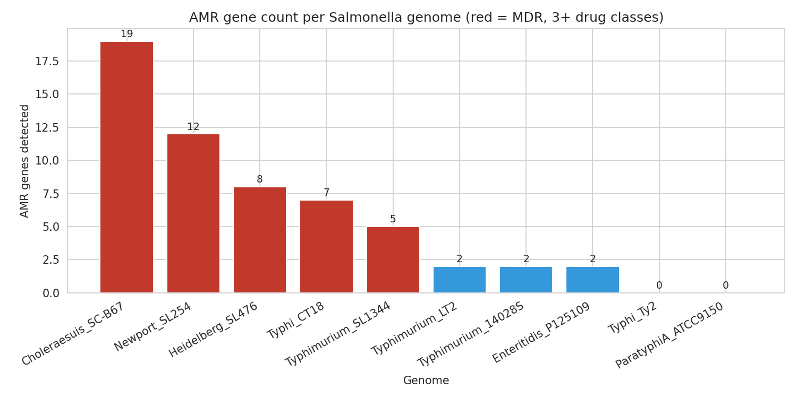
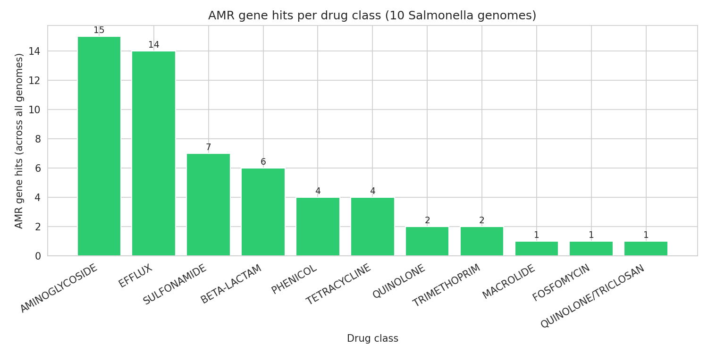
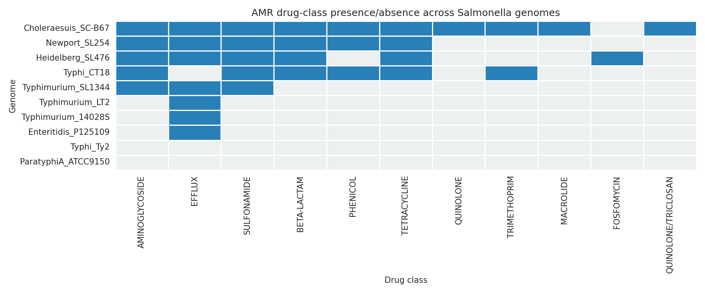

# AMR Gene Profiling Across Salmonella enterica Genomes

A short, complete bioinformatics project: download 10 public *Salmonella enterica* genome assemblies, detect antimicrobial resistance genes with NCBI AMRFinderPlus, and summarize the resistance landscape with tables and publication-ready figures. Built as a portfolio project demonstrating genome-scale AMR analysis.

## Overview

Antimicrobial resistance (AMR) in *Salmonella* is a major public health concern, with multidrug-resistant (MDR) clones spreading globally. This project asks a simple question: how does the AMR gene content differ across 10 well-known *Salmonella enterica* strains? The pipeline downloads complete genome assemblies from NCBI, runs AMRFinderPlus in nucleotide mode, and produces per-genome and per-drug-class summaries plus three figures.

## Dataset

- Source: NCBI RefSeq and GenBank, downloaded with the NCBI Datasets CLI
- Organism: *Salmonella enterica* subsp. *enterica*, 10 strains (9 complete genomes, 1 contig-level)
- Serovars: Typhimurium (LT2, SL1344, 14028S), Typhi (CT18, Ty2), Enteritidis (P125109), Heidelberg (SL476), Newport (SL254), Choleraesuis (SC-B67), Paratyphi A (ATCC 9150)
- Full accession list: `data/genome_metadata.csv`
- Reproduce the download: `bash data/download_assemblies.sh` (assemblies are not bundled in the repo; they are ~50 MB total)

## Methods

1. Assemblies downloaded from NCBI (`datasets download genome accession`, see `data/download_assemblies.sh`).
2. AMR gene detection with **NCBI AMRFinderPlus 4.2.7**, database version **2026-08-07.1**, nucleotide mode (`amrfinder -n`), organism *Salmonella*, with `--plus` for enhanced detection. One TSV per genome in `results/amrfinder_raw/`.
3. Analysis in Python (`amr_analysis.py`, pandas/matplotlib/seaborn): combined hit table, per-genome and per-drug-class summaries. Only hits with element type `AMR` are counted as resistance genes; virulence and stress markers reported by AMRFinderPlus are excluded from the resistance tallies.
4. MDR is defined as resistance genes spanning 3 or more drug classes in one genome.

## Results summary

- Genomes analyzed: **10**; total AMR gene hits: **57**
- MDR genomes (3+ drug classes): **5 of 10**
- Most resistant genome: **Choleraesuis SC-B67** (GCF_000008105.1), 19 AMR genes across 10 drug classes
- Runner-up: **Newport SL254**, 12 genes across 6 classes (classic MDR pattern: blaCMY-2, tet(A), sul1/sul2, floR, aminoglycoside modifiers)
- Top drug classes: **aminoglycoside** (15 hits, 5 genomes), **efflux** (14 hits, 7 genomes), **sulfonamide** (7 hits, 5 genomes)
- Two genomes carried **zero** AMR genes: **Typhi Ty2** and **Paratyphi A ATCC 9150** (their AMRFinderPlus hits were virulence genes only), consistent with their known antibiotic-susceptible phenotypes

## Figures





## Requirements

- NCBI AMRFinderPlus 4.2.7 with database 2026-08-07.1 (`amrfinder --update`)
- NCBI Datasets CLI (for `data/download_assemblies.sh`)
- Python 3 with pandas, matplotlib, seaborn

## How to run

From the repository root:

```bash
# 1. Download the 10 assemblies (~50 MB)
bash data/download_assemblies.sh

# 2. Run AMRFinderPlus on each genome (nucleotide mode, Salmonella organism)
for f in data/assemblies/*.fna; do
  label=$(basename "$f" .fna)
  amrfinder -n "$f" -O Salmonella -o "results/amrfinder_raw/${label}.tsv" --plus
done

# 3. Combine results and build figures/tables
python3 amr_analysis.py
```

## Repository layout

```
salmonella-amr-gene-profiling/
├── amr_analysis.py            # the full analysis, commented by section
├── data/
│   ├── download_assemblies.sh # reproduces the NCBI download
│   └── genome_metadata.csv    # accession, serovar, strain, assembly level
├── results/
│   ├── amrfinder_raw/         # per-genome AMRFinderPlus TSV outputs
│   ├── amr_genes_combined.csv # all AMR hits in one table
│   ├── per_genome_summary.csv # gene/class counts and MDR flag per genome
│   └── per_class_summary.csv  # hit counts per drug class
├── figures/                   # 3 PNG figures (see above)
└── README.md
```

## Reference

Feldgarden M, Brover V, Gonzalez-Escalona N, et al. AMRFinderPlus and the Reference Gene Catalog facilitate examination of the genomic links among antimicrobial resistance, stress, and virulence. *Sci Rep*. 2021;11:12728. doi:10.1038/s41598-021-91456-0
